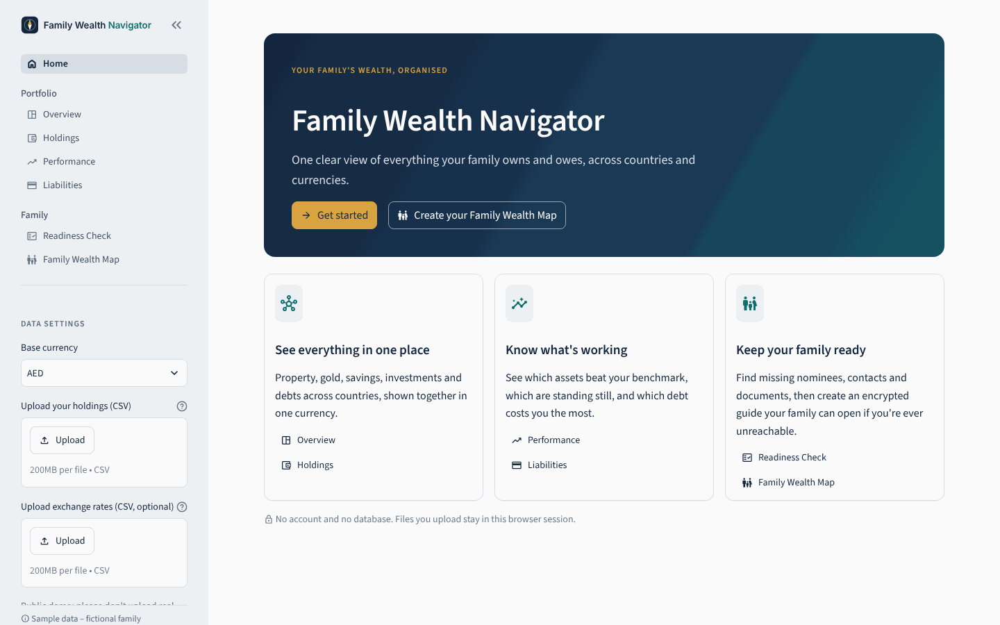
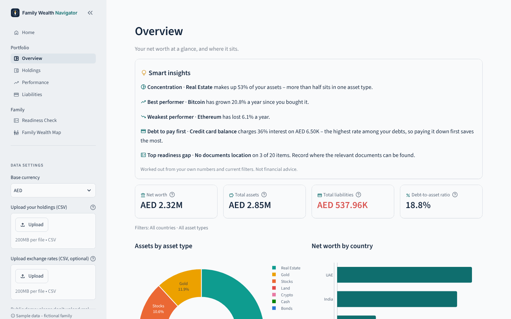
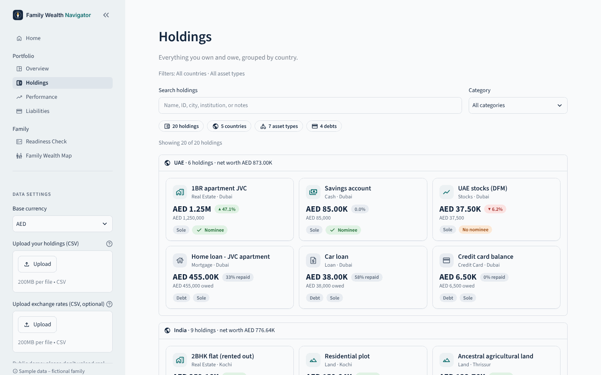
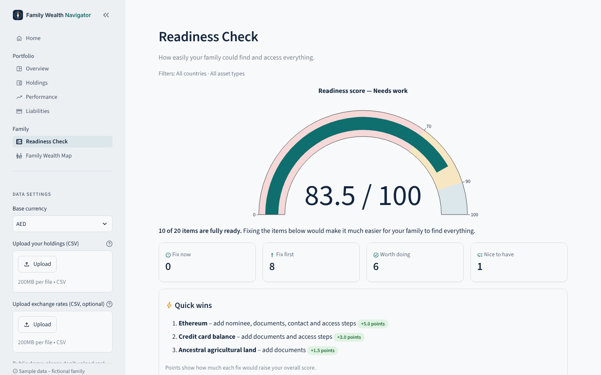
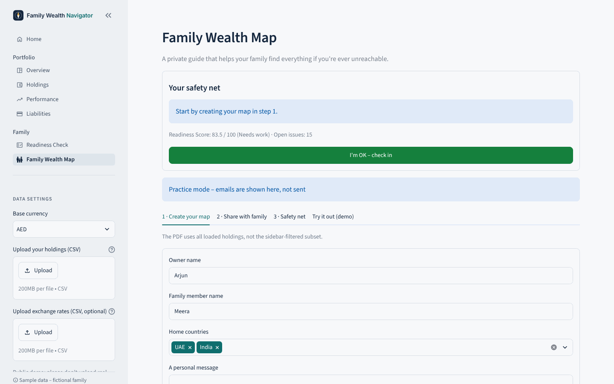

# Family Wealth Navigator

**One clear view of everything your family owns and owes – across countries and currencies – and a private guide so your family can find it all if you're ever unreachable.**

**Live demo:** https://family-wealth-navigator-app.replit.app
*(Public demo with a fictional family. Please don't upload real financial data.)*

Built as the Week 1 project of the *Mastering Agentic AI* course (Path C – build your own vibe-coded app), using **Replit Agent** and **Claude Code**.



---

## The problem

Many families hold wealth in more than one country: a flat in India, savings and stocks in the UAE, gold, crypto, a home loan, a credit card. Usually only one person knows where everything is, which bank holds it, who the nominee is and where the papers are kept.

That causes two problems:

1. **No single picture.** It is hard to see total net worth, which assets are growing, and which debts cost the most when values sit in different currencies and places.
2. **The family is not ready.** If the main person is ill, travelling or unreachable, the family may not know what exists or how to access it.

Family Wealth Navigator solves both with a simple CSV-based app – no account and no database.

---

## Features

| Page | What it does |
|---|---|
| **Home** | Landing page with a short guide to every page. |
| **Overview** | Net worth, assets, liabilities and debt-to-asset ratio in AED, INR or USD. Smart insights (concentration, best/worst performer, debt to pay first, top readiness gap). Allocation donut, net worth by country, treemap. |
| **Holdings** | Card view of every asset and debt, grouped by country, with search, category filter, gain/loss and nominee status. |
| **Performance** | Gain, annualised growth (CAGR) and a **Performing / Stagnant / Losing** label against a benchmark you choose with a slider. |
| **Liabilities** | Outstanding balances, % repaid, weighted average interest rate and warnings for high-interest debt. |
| **Readiness Check** | A 0–100 score showing how easily the family could find and access everything, a prioritised checklist (Fix now / Fix first / Worth doing / Nice to have) and quick wins with the points each fix adds. Warns if someone stores a password or seed phrase in the data. |
| **Family Wealth Map** | Creates an **AES-256 password-protected PDF** that tells the family *where* things are – never the passwords. Can share it on request, plus a safety-net check-in: two reminders before anything is shared automatically after long inactivity. Includes a "Try it out" simulation. |

<table>
  <tr>
    <td></td>
    <td></td>
  </tr>
  <tr>
    <td></td>
    <td></td>
  </tr>
</table>

---

## How it works

**Currency conversion** – every value is converted through AED using `data/fx_rates.csv`:

```text
base value = original value × source rate_to_aed ÷ base rate_to_aed
```

**Readiness score** – each asset or debt starts at 100 points:

| Issue | Severity | Effect |
|---|---|---|
| Password, PIN or seed phrase in the data | Critical | item score → 0 |
| No nominee, no documents location, no access instructions | High | −30 each |
| No contact person | Medium | −15 |
| Value older than 12 months | Low | −5 |

The overall score is the average of all item scores, so one bad item can't wipe out the whole score.

**Safety-net check-in** – if the owner does not check in:

| Days without check-in | Action |
|---|---|
| 150 | Reminder 1 to the owner |
| 165 | Reminder 2 (final reminder) |
| 180 | Family Wealth Map shared – only if reminder 2 was sent at least 7 days earlier |

Reminders are never skipped. Clicking **I'm OK – check in** resets the timer. The "Try it out" demo uses a separate simulated state, so it never affects real check-ins.

---

## How I built it

1. **Planned with Claude** – picked the idea, wrote a fictional dataset (a family in Dubai with assets in the UAE, India, Singapore and the US) and split the app into 8 small prompts.
2. **Built with Replit Agent** – one prompt per feature (data loading → Overview → Performance → Liabilities → Readiness → Family Wealth Map → polish), testing each step before the next.
3. **Checked the numbers myself** – net worth, CAGR, weighted interest and readiness scores were verified independently, and fixes were prompted when something was off.
4. **Redesigned the UI with Claude Code** in VS Code – theme, landing page, KPI cards, smart insights, card-based Holdings and a friendlier Readiness checklist, guided by a `CLAUDE.md` file that keeps the calculation logic unchanged.
5. **Tested and published** – 35 automated tests, then deployed on Replit and pushed to GitHub.

**Tech stack:** Python · Streamlit · pandas · Plotly · fpdf2 · pypdf (AES-256) · unittest/pytest

---

## Run it locally

Requires Python 3.12 or newer.

```bash
git clone https://github.com/AbdulKader-devs90/family-wealth-navigator.git
cd family-wealth-navigator
pip install -r requirements-local.txt
streamlit run app.py
```

On Windows, use `py -m pip install -r requirements-local.txt` and `py -m streamlit run app.py`.

Run the tests:

```bash
python -m pytest            # or: python -m unittest discover -s tests
```

**On Replit**, dependencies come from `pyproject.toml` / `uv.lock`; press **Run**. The app serves on port 5000 (mapped to 80).

### Demo mode and email

`PUBLIC_DEMO` defaults to `true`. In demo mode, settings, uploads and PDFs stay in the visitor's browser session, and **no real emails are sent** – they are previewed on screen.

For a private copy only, set `PUBLIC_DEMO=false` and add `SMTP_HOST`, `SMTP_PORT`, `SMTP_USER` and `SMTP_PASSWORD` as secrets to enable real email and saved check-in history (`state/`, excluded from git).

---

## Use your own data

The sidebar lets you upload your own holdings CSV (and optionally exchange rates) for the current session.

<details>
<summary><b>CSV format</b></summary>

Use UTF-8, dates as `YYYY-MM-DD`, numbers without currency symbols or thousands separators. All headers must be present even if values are blank.

**`data/holdings.csv`** – one row per asset or liability:

```csv
item_id,category,asset_type,item_name,country,city,currency,quantity,unit,purchase_date,purchase_value,current_value,last_valued_on,interest_rate_pct,held_with,account_ref,ownership,nominee,nominee_relation,contact_person,contact_email,documents_location,access_instructions,notes
```

- `category`: `Asset` or `Liability`.
- `asset_type`: e.g. Land, Real Estate, Gold, Cash, Stocks, Bonds, Crypto, Mortgage, Loan, Credit Card.
- For liabilities, `purchase_value` is the original loan and `current_value` the outstanding balance (positive number).
- `interest_rate_pct`: e.g. `6` for 6%, or blank.
- Nominee, contact, documents and access fields feed the Readiness Check and the Family Wealth Map. **Describe where secrets are kept – never the secrets themselves.**

**`data/fx_rates.csv`:**

```csv
currency,rate_to_aed,as_of
AED,1,2026-09-30
INR,0.0418,2026-09-30
USD,3.6725,2026-09-30
```

Every holdings currency needs a rate. Rates must be positive and unique per currency, and AED must be 1.

</details>

---

## Security and privacy

- **Fictional data only** – the bundled family and exchange rates are made up. This is a demo, not storage for real financial data.
- **Encrypted in memory** – the PDF is AES-256 encrypted and never written to the server's disk.
- **Passwords never stored or emailed** – share the PDF password in person, separately.
- **No secrets in the data** – the Readiness Check flags anything that looks like a password, PIN or seed phrase.
- **No paid services, API keys or database.**

## Limitations and next steps

- Exchange rates are fixed demo rates, not live.
- Check-ins run when the page is used; a production version would need a daily scheduled job.
- Light theme only.
- Ideas: live FX rates, an in-app form to add holdings, target vs actual allocation, an AI-written summary.
